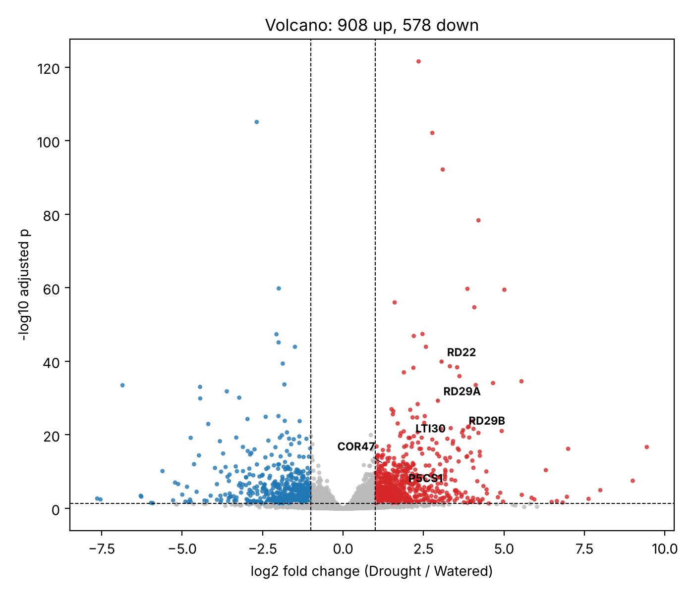
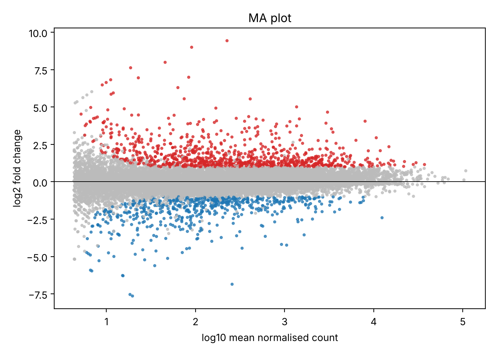
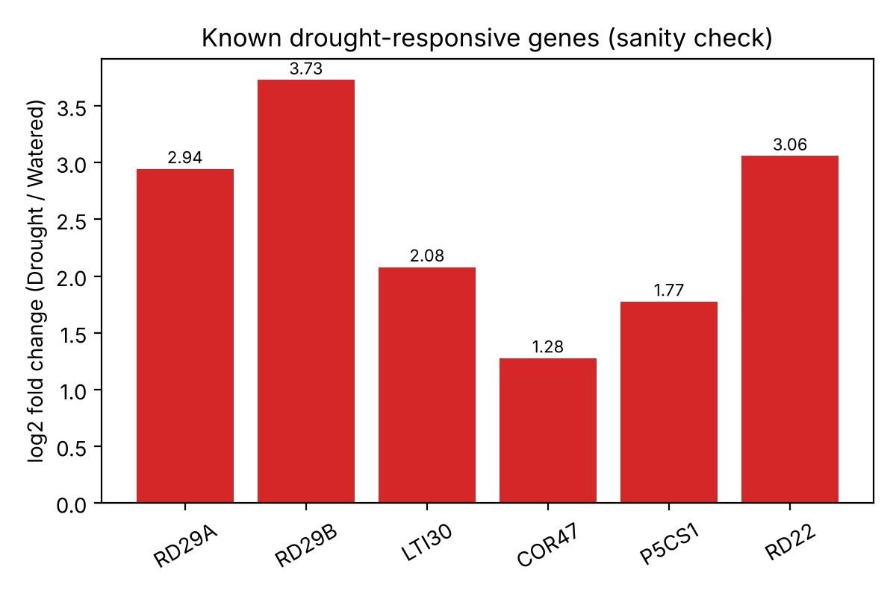
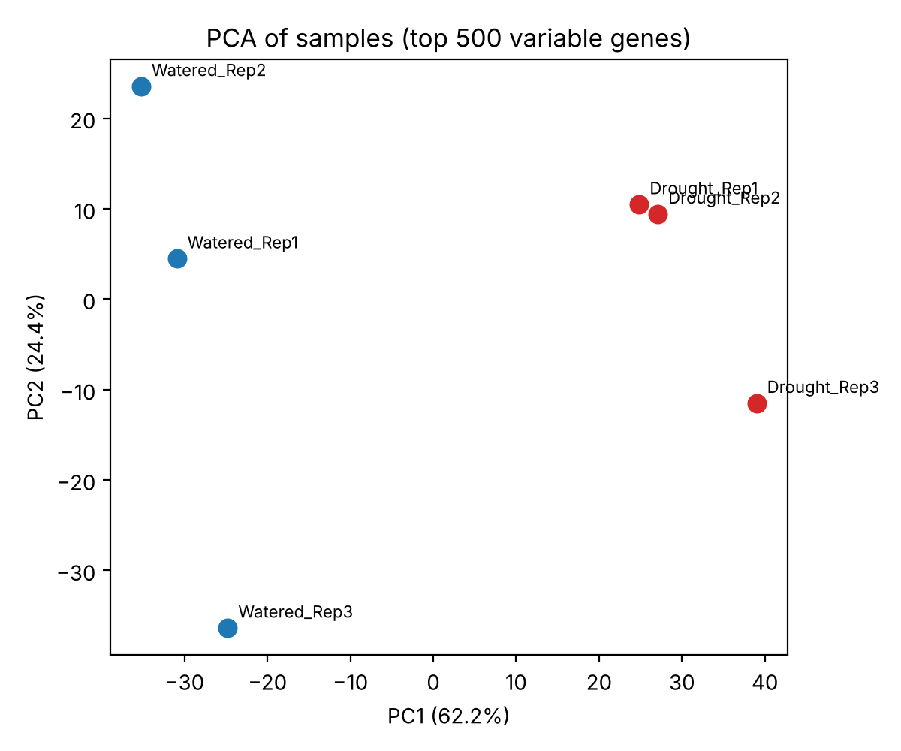
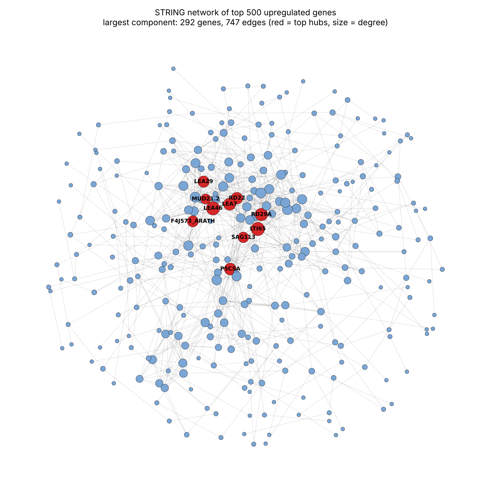

# Transcriptomic Reanalysis of the Drought Response in *Arabidopsis thaliana* Roots (GEO: GSE119382)

**Differential expression analysis with PyDESeq2 and protein-interaction network analysis with STRING and NetworkX**

**Author:** Koyel Pandey, B.Sc. (Biotechnology, Biochemistry, Genetics), REVA University, Bengaluru, India
**Project type:** Independent computational mini-project (secondary analysis of public data)
**Analysis period:** November 2026

---

## Abstract

Drought is a major abiotic stress limiting plant growth and crop yield. This project reanalysed a public root RNA-seq dataset (GEO: GSE119382) to identify genes whose expression changes in wild-type *Arabidopsis thaliana* roots after five days of water withdrawal, and to examine how the most strongly upregulated genes are connected in a protein-interaction network.

Raw gene counts for the six wild-type samples (three drought, three watered) were obtained from a public reanalysis of the dataset. After filtering, 22,399 genes were tested with PyDESeq2, an implementation of the DESeq2 negative binomial model. Using adjusted p < 0.05 and |log2 fold change| ≥ 1, 908 genes were upregulated and 578 downregulated under drought. These numbers agree to within 1% with the published reanalysis (904 and 576). Canonical drought-responsive genes, including *RD29A*, *RD29B*, *LTI30*, *COR47* and *RD22*, were strongly induced, and sample separation by treatment was confirmed by principal component analysis.

The 500 most significantly upregulated genes were mapped in STRING (v12.5; 774 interactions among 333 genes). Network analysis identified LEA proteins, RD29A and RD29B as the most connected genes and the proline biosynthesis gene *P5CSA* as the gene with the highest betweenness centrality (0.17). Only 9.0% of the interactions are supported by experimental evidence, so the hub genes are interpreted as candidates for follow-up and not as validated regulators.

---

## 1. Introduction

### 1.1 Background

- Drought is one of the main abiotic stresses affecting plant growth and crop productivity, and understanding the genes involved is a central goal of plant stress biology.
- *Arabidopsis thaliana* is the reference model plant. It has a small, well-annotated genome and extensive public datasets, which makes it suitable for developing and testing a transcriptomics workflow against established literature.
- Roots are the first organ to perceive soil water deficit, so root transcriptomes are informative for early drought responses.
- RNA sequencing (RNA-seq) measures transcript abundance genome-wide. Differential expression analysis compares abundance between conditions to identify genes that respond to a treatment.

### 1.2 Rationale

- The author's research experience is in phenotype-level plant stress work (plasma seed treatment of okra and roselle, with growth and antioxidant measurements).
- This project was undertaken to build skills in the molecular and computational side of stress biology: processing count data, applying appropriate statistics, and interpreting results in a network context.
- A public dataset allows the complete workflow to be practised and benchmarked against a published analysis. No plasma-treatment data are used or claimed in this project.

### 1.3 Aims

1. Identify genes differentially expressed between drought and watered wild-type *A. thaliana* roots.
2. Assess the reliability of the workflow by comparison with a published reanalysis and with known drought-responsive genes.
3. Construct a protein-interaction network of the most significant upregulated genes and rank genes by connectivity and centrality.
4. State the limits of what the results can support.

---

## 2. Data

- **Accession:** GEO GSE119382
- **Study title:** "Transcriptomic study of Arabidopsis roots overexpressing the brassinosteroid receptor BRL3, in control conditions and under severe drought"
- **Source publication:** Fàbregas et al. (2018), *Nature Communications* 9:4680
- **Organism and tissue:** *Arabidopsis thaliana*, roots
- **Treatment:** control (properly watered) versus five days of drought (water withheld)
- **Replication:** three biological replicates per genotype and condition, as stated in the study description
- **Genotypes:** wild type (WT) and a BRL3-overexpressing line (35S:BRL3-GFP)
- **Count table:** `data/counts_all_11samples_raw.tsv`, raw integer counts for 32,833 genes across 11 samples, taken from a public third-party reanalysis of this dataset (github.com/YuntongMeng/arabidopsis-drought-rnaseq). Gene identifiers are TAIR AGI codes (for example AT5G52310).
- **Samples analysed:** the six wild-type samples (Drought Rep1-3, Watered Rep1-3).
- **Samples not analysed:** the BRL3-overexpressing line (five samples; one watered replicate is absent from the table). The question addressed here is the drought response of wild-type plants, and including the transgenic genotype would confound drought with genotype.

---

## 3. Methods


*Figure 1. Analysis workflow.*

### 3.1 Software

| Tool | Purpose |
| --- | --- |
| Python 3 | Analysis environment |
| PyDESeq2 0.5.4 | Differential expression (Python implementation of DESeq2) |
| pandas, NumPy | Data handling |
| scikit-learn | Principal component analysis |
| matplotlib | Figures |
| STRING v12.5 (web interface) | Protein-interaction data |
| NetworkX | Graph construction and centrality measures |

### 3.2 Data preparation

- Raw counts for the six wild-type samples were loaded and labelled by condition (Drought or Watered).
- Genes with a total count below 10 across the six samples were removed, leaving **22,399 of 32,833 genes**. Genes with almost no reads carry little statistical information and increase the multiple-testing burden.

### 3.3 Differential expression

- **Input:** raw (un-normalised) counts, as required by the DESeq2 model, which performs its own normalisation.
- **Model:** negative binomial generalised linear model with design `~ condition`, contrast Drought versus Watered. The negative binomial distribution accounts for the overdispersion typical of RNA-seq counts.
- **Normalisation:** median-of-ratios size factors correct for differences in sequencing depth.
- **Dispersion:** estimated per gene and shrunk towards a fitted mean-dispersion trend, which stabilises estimates with few replicates.
- **Testing:** Wald test per gene, with Benjamini-Hochberg correction for multiple testing (adjusted p, "padj").
- **Significance thresholds:**
  - Upregulated: padj < 0.05 and log2 fold change ≥ +1
  - Downregulated: padj < 0.05 and log2 fold change ≤ -1
- 21,527 genes received a valid adjusted p-value (PyDESeq2 returns NA for genes excluded by its outlier and independent-filtering rules).

### 3.4 Quality and plausibility checks

- Principal component analysis (PCA) of log2 normalised counts (500 most variable genes) to assess whether samples separate by condition.
- Comparison of the numbers of upregulated and downregulated genes with those reported by the public reanalysis for the same six samples.
- Inspection of canonical drought-responsive genes (*RD29A*, *RD29B*, *LTI30*, *COR47*, *RD22*, *P5CS1*) and of two transcription factors not expected to show a strong response in roots at this time point (*ATAF1*, *DREB2A*).

### 3.5 Protein-interaction network

- **Gene set:** the 500 most significantly upregulated genes, ranked by adjusted p-value (`results/up_gene_ids_top500_for_STRING.txt`). Ranking by adjusted p-value favours statistically reliable changes over large but noisy fold changes at low expression.
- **STRING:** v12.5, *A. thaliana* (taxon 3702), minimum combined confidence 0.4 (medium), accessed 10 November 2026. The gene list was submitted through the STRING website (Multiple proteins) and the network was exported as a TSV file (`data/string_interactions.tsv`).
- **Graph analysis (NetworkX):** genes are nodes and interactions are undirected edges. Two measures were computed:
  - **Degree:** the number of connections of a gene.
  - **Betweenness centrality:** the fraction of shortest paths between other gene pairs that pass through a gene, indicating a bridging role between network regions.
- **Evidence audit:** the evidence channels recorded in the STRING export (experiments, text-mining, co-expression, database annotation, homology, gene neighbourhood) were tabulated across all edges.

---

## 4. Results

### 4.1 Differential expression

| Quantity | Value |
| --- | --- |
| Genes tested (after filtering) | 22,399 |
| Genes with valid adjusted p-value | 21,527 |
| Upregulated in drought | **908** (log2FC +1.0 to +9.43; median +1.47) |
| Downregulated in drought | **578** (log2FC -1.0 to -7.64; median -1.59) |
| Not significant | 20,041 |



*Figure 2. Volcano plot. Red: upregulated; blue: downregulated; grey: not significant. Dashed lines mark padj = 0.05 and |log2FC| = 1. Selected drought-responsive genes are labelled.*



*Figure 3. MA plot. Most genes lie around zero after normalisation. The largest fold changes occur at low expression, where estimates are least precise.*

### 4.2 Agreement with the public reanalysis

| | Upregulated | Downregulated |
| --- | --- | --- |
| This analysis (PyDESeq2) | 908 | 578 |
| Public reanalysis (same six samples) | 904 | 576 |
| Difference | 4 (0.4%) | 2 (0.3%) |

The close agreement indicates that the implementation behaves consistently with the published analysis. Because both analyses use the same count table and the same model family, this is a consistency check and not an independent validation.

### 4.3 Canonical drought-responsive genes

| Gene | AGI ID | log2FC | padj | Call |
| --- | --- | --- | --- | --- |
| RD29A | AT5G52310 | +2.94 | 5.2e-30 | Up |
| RD29B | AT5G52300 | +3.73 | 5.2e-22 | Up |
| LTI30 | AT3G50970 | +2.08 | 6.7e-20 | Up |
| COR47 | AT1G20440 | +1.28 | 8.9e-13 | Up |
| RD22 | AT5G25610 | +3.06 | 1.2e-40 | Up |
| P5CS1 (P5CSA) | AT2G39800 | +1.77 | 2.3e-12 | Up |
| ATAF1 | AT1G01720 | +0.10 | 0.85 | Not significant |
| DREB2A | AT5G05410 | -0.72 | 0.015 | Not significant (below the 2-fold cut-off) |



*Figure 4. log2 fold change of canonical drought-responsive genes.*

Classic abscisic acid (ABA)- and dehydration-responsive genes were strongly induced, as expected from the literature. *ATAF1* and *DREB2A* did not meet the thresholds in roots in this dataset. Some stress-related transcription factors respond transiently or in a tissue- or time-specific manner; this was not investigated further.

### 4.4 Sample relationships



*Figure 5. Principal component analysis of the six samples (500 most variable genes).*

- PC1 (62.2% of variance) separates drought from watered samples, so treatment is the dominant source of variation.
- PC2 (24.4%) mainly reflects variation among replicates; the watered replicates are spread apart, illustrating the variability that three replicates cannot fully average out.

### 4.5 Most significant genes


*Figure 6. Heatmap of the 40 most significant upregulated (top) and 40 most significant downregulated (bottom) genes, z-scored per gene. These genes were selected for significance, so the pattern is cleaner than for the dataset as a whole.*

| Gene (AGI) | log2FC | padj |
| --- | --- | --- |
| AT3G53980 | +2.35 | 2.9e-122 |
| AT2G15970 | +2.77 | 7.9e-103 |
| AT5G11110 | +3.09 | 7.1e-93 |
| AT4G33550 | +4.21 | 4.6e-79 |
| AT5G59320 | +3.86 | 1.9e-60 |

The full table is provided in `results/deg_results.csv`.

### 4.6 Protein-interaction network

- 495 of the 500 submitted genes were matched in STRING.
- The network contains **774 unique interactions among 333 genes**; the remaining 162 matched genes have no interaction at confidence ≥ 0.4.
- A single connected component contains 292 genes and 747 edges; the remaining 27 edges form small separate groups.
- Combined confidence scores range from 0.40 to 0.999 (median 0.54).



*Figure 7. Largest connected component of the network. Node size is proportional to degree; red nodes are the top hubs and P5CSA.*

| Gene | Degree | Betweenness |
| --- | --- | --- |
| LEA46 | 31 | 0.091 |
| LTI65 (RD29B) | 31 | 0.074 |
| RD29A | 27 | 0.078 |
| LEA7 | 25 | 0.026 |
| **P5CSA** | 24 | **0.173 (highest)** |
| RD22 | 23 | 0.063 |
| LEA29 | 22 | 0.021 |
| F4J573_ARATH | 21 | 0.021 |
| SAG113 | 19 | 0.035 |
| MUD21.2 | 17 | 0.040 |

*Table 1. Top ten genes by degree. F4J573_ARATH is shown by its UniProt-style name because STRING lists no gene symbol for it.*

*P5CSA* has the highest betweenness (0.17) despite not having the highest degree, indicating that it lies on many shortest paths between otherwise separate parts of the network.

**Evidence supporting the interactions** (an edge may have several evidence types):

| Evidence type | % of edges |
| --- | --- |
| Text-mining | 90.2 |
| Co-expression | 73.3 |
| Database annotation | 12.7 |
| Experiments | 9.0 |
| Homology | 6.3 |
| Gene neighbourhood | 5.0 |

For 21.6% of edges, text-mining is the only listed evidence type.


*Figure 8. Left: degree distribution. Right: evidence types supporting the 774 interactions.*

---

## 5. Discussion

- **Consistency with known biology.** The most connected genes include LEA proteins (LEA46, LEA7, LEA29), RD29A and RD29B, which are ABA- and dehydration-responsive genes associated with protection against cellular water loss. Their prominence is consistent with established drought biology and supports the workflow.
- **Proline metabolism.** *P5CSA* encodes a key enzyme of proline biosynthesis. Proline accumulates as an osmoprotectant under drought, so a proline-synthesis gene with high betweenness is biologically plausible.
- **Interpretation of hubs.** In an interaction network, a hub is a gene with many recorded or predicted links. This reflects how extensively a gene has been studied as well as its biological role, and does not demonstrate that the gene regulates its neighbours.
- **Network as a hypothesis tool.** Because most interactions are predicted (text-mining, co-expression), the network is useful for prioritising candidate genes for follow-up and not for establishing regulatory relationships.
- **Relation to plant stress research more broadly.** Drought and other stresses engage overlapping responses, including reactive oxygen species signalling. The same workflow could in principle be applied to transcriptomes from other stress or priming treatments. This was not done here.

---

## 6. Limitations

- **Source of counts.** The count table was generated by a third party. Read quality control, alignment and counting are outside the scope of this project.
- **Sample size.** Three replicates per condition limit the precision of variance estimates, and individual samples can influence the gene lists. The PCA illustrates the spread among watered replicates.
- **Scope of the data.** One tissue (roots), one time point (five days of water withdrawal) and one study. Results may not generalise to other tissues, stresses or time points.
- **Nature of validation.** Agreement with a reanalysis of the same data and recovery of known genes are consistency checks. They do not provide independent biological validation.
- **No experimental confirmation.** Candidate genes would require confirmation, for example by qRT-PCR in independent plants.
- **Reliability of network edges.** Only 9.0% of interactions have experimental evidence, and 90.2% involve text-mining, which favours well-studied genes.
- **Selection effect.** All 500 network genes were selected because they are upregulated together, so co-expression links are partly expected and do not independently indicate shared function.
- **Threshold dependence.** The numbers of differentially expressed genes depend on the chosen padj and fold-change thresholds.
- **Analyses not performed.** Gene Ontology or KEGG enrichment, promoter motif analysis, and comparison with the BRL3-overexpressing genotype.

---

## 7. Conclusions

- A DESeq2-based Python workflow reproduced a published reanalysis to within 1% (908 up / 578 down compared with 904 / 576) and recovered canonical drought-responsive genes.
- Drought altered the expression of 1,486 genes (6.9% of genes with a valid adjusted p-value) in wild-type *Arabidopsis* roots, with a profile dominated by ABA- and dehydration-responsive genes.
- Network analysis highlighted LEA proteins, RD29A/RD29B and the proline-biosynthesis gene *P5CSA* as the most connected or bridging upregulated genes. These are candidates for experimental follow-up and not validated regulators.

---

## 8. Reproducibility

```bash
pip install -r requirements.txt
python src/deseq2_analysis.py      # 908 up / 578 down -> results/deg_results.csv
python src/make_figures.py         # figures 1-5
python src/make_string_input.py    # top-500 gene list for string-db.org
# STRING website: Multiple proteins -> Arabidopsis thaliana -> Exports -> TSV, saved as data/string_interactions.tsv
python src/network_hubs.py --edges data/string_interactions.tsv
python src/network_figures.py      # network and evidence figures
```

```
plant-stress-insilico/
├── README.md
├── REPORT.md
├── REPORT.pdf
├── requirements.txt
├── data/
│   ├── counts_all_11samples_raw.tsv     # third-party raw counts
│   └── string_interactions.tsv          # STRING v12.5 export
├── src/
│   ├── deseq2_analysis.py
│   ├── make_figures.py
│   ├── make_workflow_fig.py
│   ├── make_string_input.py
│   ├── network_hubs.py
│   └── network_figures.py
├── results/
│   ├── deg_results.csv
│   ├── normalized_counts.csv
│   ├── ppi_edges.csv
│   ├── ppi_hubs.csv
│   └── up_gene_ids_top500_for_STRING.txt
└── figures/
```

---

## 9. References

1. Fàbregas N, et al. (2018). Overexpression of the vascular brassinosteroid receptor BRL3 confers drought resistance without penalizing plant growth. *Nature Communications* 9:4680.
2. Love MI, Huber W, Anders S (2014). Moderated estimation of fold change and dispersion for RNA-seq data with DESeq2. *Genome Biology* 15:550.
3. Muzellec B, Teleńczuk M, Cabeli V, Andreux M (2023). PyDESeq2: a Python package for bulk RNA-seq differential expression analysis. *Bioinformatics* 39(9):btad547.
4. Benjamini Y, Hochberg Y (1995). Controlling the false discovery rate: a practical and powerful approach to multiple testing. *Journal of the Royal Statistical Society B* 57:289-300.
5. STRING database, v12.5 (string-db.org), accessed 10 November 2026.
6. Hagberg AA, Schult DA, Swart PJ (2008). Exploring network structure, dynamics, and function using NetworkX. *Proceedings of the 7th Python in Science Conference (SciPy 2008)*.
7. NCBI Gene Expression Omnibus, accession GSE119382.
8. Public reanalysis count table: github.com/YuntongMeng/arabidopsis-drought-rnaseq.

---

## Appendix A. Scope and contribution

| Stage | Performed by |
| --- | --- |
| Plant growth, drought treatment, RNA extraction and sequencing | Original authors of GSE119382 |
| Read alignment and generation of the raw count table | Public third-party reanalysis |
| Sample selection, filtering, differential expression, threshold setting | This project |
| Comparison with the public reanalysis and with known drought genes | This project |
| STRING network construction, centrality analysis and interpretation | This project |
| Experimental validation, GO/KEGG enrichment, promoter-motif analysis | Not performed |
