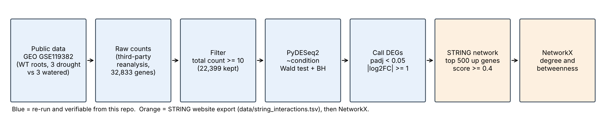
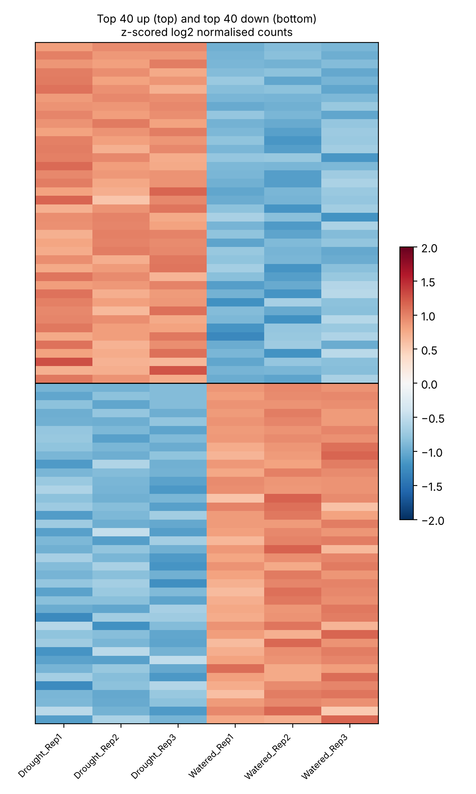
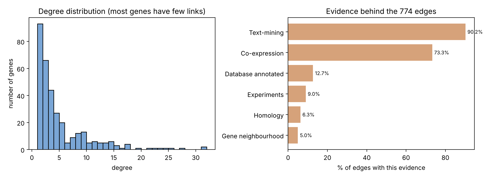

# Transcriptomic Reanalysis of Drought Response in *Arabidopsis thaliana* Roots (GEO: GSE119382)

**Differential expression with PyDESeq2 and protein-interaction network analysis with STRING and NetworkX**

- **Author:** Koyel Pandey, BSc (Biotechnology, Biochemistry, Genetics), REVA University, Bengaluru
- **Type:** Independent computational mini-project (reanalysis of public data)
- **Date of final re-run:** 13 November 2026
- **Code and data:** this repository (`src/`, `data/`, `results/`, `figures/`)

---

## 0. Project at a glance

- **Question:** which genes change in *Arabidopsis* roots under drought, and which of them look most "central" in a protein-interaction network?
- **Data:** public RNA-seq, GEO GSE119382, wild-type roots, 3 drought vs 3 watered samples
- **Method:** PyDESeq2 (DESeq2 model in Python) → STRING network → NetworkX centrality
- **Main result:** **908 genes up, 578 down** (adjusted p < 0.05, |log2FC| ≥ 1) from 22,399 genes tested
- **Cross-check:** the public reanalysis I took the counts from reports 904 up and 576 down, so the two agree to within 1%
- **Sanity check:** known drought genes come out strongly up (RD29A +2.94, RD29B +3.73, LTI30 +2.08, COR47 +1.28, RD22 +3.06)
- **Network:** top 500 up genes → 774 interactions among 333 genes; P5CSA (proline synthesis) has the highest betweenness (0.17)
- **Honest scope:** this is a **reanalysis of someone else's experiment, starting from someone else's count table**. The sequencing, read alignment and counting are not my work. Everything from the count table onwards is.

### 0.1 What I did and what I used (say this before anyone asks)

| Step | Who did it |
| --- | --- |
| Growing plants, drought treatment, RNA extraction, sequencing | The original authors of GSE119382 |
| Aligning reads and making the raw count table | A public third-party reanalysis (github.com/YuntongMeng/arabidopsis-drought-rnaseq) |
| Selecting the 6 wild-type samples, filtering, running PyDESeq2, setting thresholds | **Me** |
| Comparing my gene counts with the public reanalysis | **Me** |
| Checking known drought genes as a sanity test | **Me** |
| STRING network, hub ranking, interpretation | **Me** |
| Wet-lab validation (qPCR), GO enrichment, promoter-motif analysis | **Not done** |

---

## 1. Background and rationale

### 1.1 Why drought and why *Arabidopsis*

- **Drought** is one of the main abiotic stresses limiting crop yield, so understanding which genes respond to it is a standard goal in plant biology.
- ***Arabidopsis thaliana*** is the reference model plant: small genome, the best-annotated plant genome, and large public datasets. That makes it the right place to *practise* a transcriptomics workflow where results can be checked against decades of literature.
- **Roots** are the first organ to sense soil water loss, so root transcriptomes are a natural place to look for early drought responses.

### 1.2 Why I did this project

- At IISc (Plasma Applications Lab) I work on how plasma seed treatment affects okra and roselle, which is **phenotype-level** work (shoot growth, antioxidant assays).
- I wanted to learn how to ask the **molecular** question: *what changes inside a plant under stress, not only how it looks?*
- A public dataset lets me learn the full workflow (counts → statistics → biology) without needing sequencing, and lets me test my method against a published answer.
- Plasma treatment is thought to act partly through reactive oxygen species (ROS) signalling, and drought also triggers ROS and stress-response pathways. I treat that as the **motivation** for learning stress transcriptomics, **not** as a result: this project contains no plasma data.

### 1.3 Aims

- **Aim 1:** identify genes differentially expressed between drought and watered wild-type roots
- **Aim 2:** check that my pipeline is trustworthy by (a) comparing with a published reanalysis and (b) confirming known drought genes
- **Aim 3:** build a protein-interaction network of the most significant upregulated genes and rank genes by connectivity and centrality
- **Aim 4:** state clearly what these results can and cannot show

---

## 2. Data

- **Accession:** GEO GSE119382 (*Arabidopsis thaliana*, root RNA-seq, drought vs watered)
- **Count table used:** `data/counts_all_11samples_raw.tsv`, raw (un-normalised) integer counts for **32,833 genes × 11 samples**, taken from a public reanalysis repository that processed GSE119382 from the SRA reads
- **Samples in the file:**
  - Wild type (WT): Drought Rep1–3, Watered Rep1–3 (**the 6 samples I used**)
  - BRL3 line (a transgenic line with extra copies of the brassinosteroid receptor BRL3): Drought Rep1–3, Watered Rep1 and Rep3 (5 samples, **not used**)
- **Why only WT:** the question is the drought response of normal plants. Mixing in the transgenic line would confound drought with genotype.
- **Gene IDs:** TAIR AGI codes (e.g. AT5G52310)
- **Design:** 3 vs 3 per condition (the sample column names indicate replicates; see Limitations)

> **To confirm on the GEO page before presenting:** the exact study title, the tissue/time-point wording, and that the six samples are biological (not technical) replicates.

---

## 3. Methods



### 3.1 Software

| Tool | Purpose |
| --- | --- |
| Python 3 | Everything |
| PyDESeq2 0.5.4 | Differential expression (Python re-implementation of DESeq2) |
| pandas, NumPy | Data handling |
| scikit-learn | PCA |
| matplotlib | Figures |
| STRING (web API, species 3702) | Protein-interaction data |
| NetworkX | Graph construction and centrality |

### 3.2 Step 1: data preparation

- Read the raw count table and kept the **6 WT columns**
- Labelled samples `Drought` or `Watered` from the column names
- **Filter:** removed genes with a total count below 10 across the 6 samples → **22,399 of 32,833 genes kept**
- **Why filter:** genes with almost no reads carry no statistical information and only add noise and multiple-testing burden

### 3.3 Step 2: differential expression (PyDESeq2)

- **Input is raw counts**, because the DESeq2 model does its own normalisation. Using already-normalised values (TPM/FPKM) would be wrong.
- **Model:** negative binomial generalised linear model, design `~ condition`, contrast Drought vs Watered
  - **Why negative binomial:** RNA-seq counts are discrete and more variable than a Poisson model allows (overdispersion)
- **Normalisation:** median-of-ratios size factors, which correct for different sequencing depth between samples
- **Dispersion:** estimated per gene, then shrunk towards a fitted trend (this is what makes 3 replicates workable)
- **Test:** Wald test per gene
- **Multiple testing:** Benjamini-Hochberg false discovery rate, reported as *adjusted p* (padj)
- **Calling differentially expressed genes (DEGs):**
  - **Up:** padj < 0.05 **and** log2 fold change ≥ +1 (at least 2-fold higher in drought)
  - **Down:** padj < 0.05 **and** log2 fold change ≤ −1
  - **Why both thresholds:** padj says the change is unlikely to be noise; the fold-change cut-off says it is big enough to matter biologically
- **Genes with a result:** 21,527 genes had a valid adjusted p-value (PyDESeq2 returns NA for genes removed by its outlier and independent-filtering rules)

### 3.4 Step 3: quality checks

- **PCA** of log2 normalised counts (500 most variable genes) to see whether samples separate by condition
- **Cross-check with the public reanalysis:** compared my number of up and down genes with the numbers that reanalysis reports for the same six samples
- **Known-gene check:** looked up canonical drought-responsive genes (RD29A, RD29B, LTI30, COR47, RD22, P5CS1) and two genes I expected *not* to change at this time point (ATAF1, DREB2A)

### 3.5 Step 4: interaction network (STRING + NetworkX)

- **Genes used:** the **500 most significantly upregulated genes**, ranked by adjusted p-value (*not* by fold change)
- **How it was run:** I exported the gene list (`results/up_gene_ids_top500_for_STRING.txt`) and pasted it into the **STRING website** (string-db.org → Multiple proteins → *Arabidopsis thaliana*), then downloaded the network as a TSV (`string_interactions_495_nodes.tsv`). The hub analysis was then run in NetworkX on that exported file.
- **STRING:** *A. thaliana* (taxon 3702), minimum combined confidence **0.4** (medium)
- **Graph:** each gene is a node, each STRING interaction an edge (duplicates removed)
- **Metrics (NetworkX):**
  - **Degree:** number of connections of a gene
  - **Betweenness centrality:** how often a gene lies on the shortest path between two other genes (a "bridge" score)
- **Evidence audit:** counted which evidence types (experiments, text-mining, co-expression, etc.) support the edges, using the evidence columns in the STRING export

---

## 4. Results

### 4.1 Differential expression

- **Genes tested:** 22,399 after filtering; 21,527 with a valid padj
- **Upregulated in drought:** **908** (log2FC from +1.0 up to +9.43, median +1.47)
- **Downregulated in drought:** **578** (log2FC from −1.0 down to −7.64, median −1.59)
- **Not significant:** 20,041


*Figure 1. Volcano plot. Red = up, blue = down, grey = not significant. Dashed lines mark padj = 0.05 and |log2FC| = 1. Known drought genes are labelled.*


*Figure 2. MA plot. The bulk of genes sits around zero, as expected after normalisation. The largest fold changes occur at low expression, where estimates are noisiest, which is one reason I rank by adjusted p-value and not by fold change.*

### 4.2 Agreement with the public reanalysis

| | Up | Down |
| --- | --- | --- |
| **My PyDESeq2 run** | **908** | **578** |
| Public reanalysis (same 6 samples) | 904 | 576 |
| Difference | 4 (0.4%) | 2 (0.3%) |

- **What this shows:** my implementation behaves like the published analysis, so my pipeline is not producing nonsense
- **What it does not show:** independent validation. Both analyses use the same counts and the same statistical model family, so agreement is a **consistency check**, not proof that the biology is right

### 4.3 Known drought genes (sanity check)

| Gene | AGI ID | log2FC | padj | Call |
| --- | --- | --- | --- | --- |
| RD29A | AT5G52310 | +2.94 | 5.2e-30 | Up |
| RD29B | AT5G52300 | +3.73 | 5.2e-22 | Up |
| LTI30 | AT3G50970 | +2.08 | 6.7e-20 | Up |
| COR47 | AT1G20440 | +1.28 | 8.9e-13 | Up |
| RD22 | AT5G25610 | +3.06 | 1.2e-40 | Up |
| P5CS1 (P5CSA) | AT2G39800 | +1.77 | 2.3e-12 | Up |
| ATAF1 | AT1G01720 | +0.10 | 0.85 | Not significant |
| DREB2A | AT5G05410 | −0.72 | 0.015 | Not significant (below the 2-fold cut-off) |


*Figure 3. Log2 fold change of canonical drought-responsive genes.*

- **Interpretation:** the classic ABA- and dehydration-responsive genes are strongly induced, as the literature predicts
- **ATAF1 and DREB2A did not pass the thresholds in roots.** This is plausible, not an error: some stress transcription factors respond transiently or in a tissue- or time-specific way, and this dataset is one tissue at one time point. I report it rather than hide it.

### 4.4 Sample quality (PCA)


*Figure 4. PCA. PC1 (62.2% of variance) separates drought from watered samples; PC2 (24.4%) mostly reflects replicate-to-replicate spread.*

- **Good:** the main axis of variation is the treatment, so the comparison is meaningful
- **Caution:** the watered replicates are spread apart on PC2 (Rep3 and Rep2 are far from each other), which is the kind of variability that 3 replicates cannot average out

### 4.5 Top differentially expressed genes



*Figure 5. Heatmap of the 40 most significant up (top) and 40 most significant down (bottom) genes, z-scored per gene. Replicates within a condition show a consistent pattern. These genes were selected for being significant, so this looks cleaner than the dataset as a whole.*

Most significant upregulated genes (full table: `results/deg_results.csv`):

| Gene (AGI) | log2FC | padj |
| --- | --- | --- |
| AT3G53980 | +2.35 | 2.9e-122 |
| AT2G15970 | +2.77 | 7.9e-103 |
| AT5G11110 | +3.09 | 7.1e-93 |
| AT4G33550 | +4.21 | 4.6e-79 |
| AT5G59320 | +3.86 | 1.9e-60 |

### 4.6 Protein-interaction network

> Source: my STRING web export (`data/string_interactions.tsv`), analysed with `src/network_hubs.py` and `src/network_figures.py`. All numbers below are reproducible from that file.

- **Input:** top 500 upregulated genes by padj
- **Matched in STRING:** 495 of 500
- **Network size:** **774 unique interactions among 333 genes** (the other 162 matched genes have no link at confidence ≥ 0.4)
- **Connectivity:** one large connected component of **292 genes and 747 edges**; the remaining 27 edges are in small separate groups
- **Edge confidence:** combined score from 0.40 to 0.999, median 0.54 (so most edges are medium-confidence)


*Figure 6. Largest connected component. Node size = number of connections; red = top hubs and P5CSA.*

**Top hubs (ranked by degree, then betweenness)**

| Gene | Degree | Betweenness |
| --- | --- | --- |
| LEA46 | 31 | 0.091 |
| LTI65 (RD29B) | 31 | 0.074 |
| RD29A | 27 | 0.078 |
| LEA7 | 25 | 0.026 |
| **P5CSA** | 24 | **0.173 (highest)** |
| RD22 | 23 | 0.063 |
| LEA29 | 22 | 0.021 |
| F4J573_ARATH | 21 | 0.021 |
| SAG113 | 19 | 0.035 |
| MUD21.2 | 17 | 0.040 |

- **Highest betweenness: P5CSA (0.17)**, a proline biosynthesis gene
  - **Meaning:** many shortest paths between other genes pass through it, so it links otherwise separate parts of the network
  - It is not the most connected gene (24 links vs 31 for LEA46), which is the point of using betweenness as well as degree
- `F4J573_ARATH` is shown by its UniProt-style name because STRING has no gene symbol for it

**Evidence behind the 774 edges** (an edge can have several types)

| Evidence type | % of edges |
| --- | --- |
| Text-mining | 90.2% |
| Co-expression | 73.3% |
| Database annotated | 12.7% |
| **Experiments** | **9.0%** |
| Homology | 6.3% |
| Gene neighbourhood | 5.0% |

- **Edges whose only listed evidence is text-mining:** 21.6%



*Figure 7. Left: most genes have few connections and a few are hubs. Right: evidence types behind the edges.*

- **Why this matters:** a gene that is heavily studied gets mentioned with many other genes in papers, so text-mining edges favour famous genes. Co-expression edges are partly expected here because all 500 genes were selected for rising together in drought.

---

## 5. Discussion

- **The hubs are classic drought genes.** LEA proteins (LEA46, LEA7), RD29A and RD29B are ABA- and dehydration-responsive and are known to protect cells during water loss. Finding them is consistent with known drought biology, which supports the workflow.
- **LEA proteins** act as protective proteins during desiccation, and **RD29A/B** are standard markers of ABA/dehydration signalling.
- **P5CSA** encodes the rate-limiting enzyme of proline synthesis. Proline accumulates as an osmoprotectant in drought, so a proline gene that bridges network modules is biologically sensible.
- **A hub is not a regulator.** In STRING, a hub is a gene with many *recorded or predicted* links. That reflects how well-studied the gene is as much as its role. It does not show that the gene controls the others.
- **Why the network is a lead-generating tool:** with only 9% experimental edges, the network says "these genes deserve attention", not "these genes drive drought tolerance".
- **Link to my IISc work:** both plasma treatment and drought are discussed in terms of ROS and stress signalling. A natural next step would be to compare stress-responsive gene sets with transcript data from plasma-treated plants. I have not done this and do not claim it.

---

## 6. Limitations (read these before an interview)

- **Counts were not generated by me.** I started from a public count table, so read quality control, alignment and counting are outside this project.
- **n = 3 per group.** DESeq2 handles small n, but estimates of variability are weak and a single odd sample can shift the gene list. The PCA shows this spread.
- **One tissue, one time point, one study.** The result may not generalise to leaves, other stresses or other time points (ATAF1 and DREB2A not changing is an example).
- **My validation is only consistency.** Matching a reanalysis of the same data, and recovering known genes, shows the pipeline works. It does not validate any new biological claim.
- **No wet-lab confirmation.** Candidate genes would need qPCR in independent plants.
- **STRING is mostly predicted.** Only 9.0% of edges have experimental evidence; 90.2% involve text-mining (21.6% rely on it alone), which favours well-studied genes.
- **Selection effect in the network:** all 500 genes were chosen for being upregulated, so their co-expression links are partly expected and do not independently show a shared function.
- **Threshold dependence.** Different padj/fold-change cut-offs give different gene counts.
- **Not done:** GO/KEGG enrichment, promoter motif analysis (planned as an optional step, never run), comparison between the BRL3 line and wild type.

---

## 7. Conclusions

- A DESeq2-based pipeline in Python reproduced a published reanalysis to within 1% (908/578 vs 904/576 DEGs) and recovered canonical drought genes.
- Drought in wild-type *Arabidopsis* roots changed ~1,486 genes (6.9% of the genes tested), mostly consistent with ABA- and dehydration-response biology.
- Network analysis highlighted LEA proteins, RD29A/B and the proline gene P5CSA as the most connected or bridging upregulated genes; these are candidates, not validated regulators.
- The project gave me an end-to-end understanding of RNA-seq statistics and interaction-network analysis that I want to apply to gene expression and genetic variation in human disease.

---

## 8. Viva / interview questions and model answers

**Q1. What exactly did you do?**
- Took a public raw count table for GSE119382, selected 6 wild-type root samples (3 drought, 3 watered), ran differential expression with PyDESeq2, checked it against a published reanalysis and known drought genes, then built a STRING network of the top 500 upregulated genes and ranked them with NetworkX.

**Q2. Did you do the sequencing or alignment?**
- No. The experiment and the count table are not mine. My work starts at the count table.

**Q3. Why raw counts and not FPKM/TPM?**
- DESeq2 models raw counts with a negative binomial distribution and normalises internally. Pre-normalised values break its assumptions.

**Q4. What is the negative binomial and why not Poisson?**
- Poisson assumes variance equals the mean. Real RNA-seq counts vary more between replicates (overdispersion), and the negative binomial adds a dispersion parameter to model that.

**Q5. What are size factors?**
- Per-sample scaling factors (median of ratios) that correct for sequencing depth so samples are comparable.

**Q6. What is dispersion shrinkage and why does it matter with 3 replicates?**
- Per-gene variance estimates from 3 samples are noisy, so DESeq2 pulls them towards a trend fitted across all genes. This stabilises the test.

**Q7. What is padj?**
- A p-value corrected for testing ~22,000 genes at once using Benjamini-Hochberg, controlling the false discovery rate. With padj < 0.05, about 5% of the genes called significant are expected to be false positives.

**Q8. Why did you filter genes with total count < 10?**
- They have no power to be detected and only add to the multiple-testing burden.

**Q9. Why use both padj and log2FC thresholds?**
- padj says the change is unlikely to be noise; log2FC ≥ 1 says it is at least 2-fold, which is more likely to matter biologically.

**Q10. How do you know your pipeline worked?**
- Three consistency checks: 908/578 vs 904/576 in the public reanalysis; known drought genes (RD29A, RD29B, LTI30, COR47, RD22) strongly up; PCA separating conditions on PC1. These show the workflow behaves correctly, not that the biology is independently proven.

**Q11. Why didn't DREB2A or ATAF1 change?**
- Possible reasons: tissue (roots), timing (transient induction), or the stress severity. I report it as an observation; I did not test the explanations.

**Q12. What does a hub gene mean in your network?**
- A gene with many STRING links among the upregulated genes. It means "well connected", not "controls the others".

**Q13. What is betweenness and why is P5CSA interesting?**
- Betweenness counts how many shortest paths between other gene pairs pass through a gene. P5CSA has the highest (0.17), so it bridges modules. It makes proline, a known osmoprotectant, which fits drought biology.

**Q14. Why choose STRING confidence 0.4?**
- It is STRING's "medium confidence" default. Higher cut-offs give a smaller, more reliable network; lower cut-offs add more noise.

**Q15. How reliable is the network?**
- Only 9.0% of edges have experimental support. Most come from text-mining and co-expression, which favour well-studied genes. So hubs are leads.

**Q16. Why the top 500 by padj and not by fold change?**
- padj ranks the most statistically reliable changes. Fold change alone favours low-count genes with noisy large values.

**Q17. What are the biggest weaknesses?**
- n = 3, counts from a third party, one tissue and time point, no wet-lab confirmation, mostly predicted network edges.

**Q18. What would you do next?**
- GO/KEGG enrichment; test robustness to thresholds; run qPCR on candidate genes; compare with more drought datasets; extend to human disease expression data.

**Q19. How does this connect to your IISc work?**
- It is where I learned stress transcriptomics. Both plasma priming and drought involve ROS and stress signalling, so the same tools could later be applied to plasma-treated seeds. I have not done that yet.

**Q20. Can you run it again?**
- Yes. `python src/deseq2_analysis.py` reproduces 908 up and 578 down from the counts file in this repository.

---

## 9. Reproducibility

```bash
pip install -r requirements.txt
python src/deseq2_analysis.py      # 908 up / 578 down -> results/deg_results.csv
python src/make_figures.py         # figures/fig1-fig5
python src/make_string_input.py    # writes the top-500 gene list to paste into string-db.org
# STRING website: Multiple proteins -> Arabidopsis thaliana -> Exports -> TSV, save as data/string_interactions.tsv
python src/network_hubs.py --edges data/string_interactions.tsv   # -> results/ppi_*.csv
python src/network_figures.py      # figures/fig6-fig7 and evidence audit
```

### Repository layout

```
plant-stress-insilico/
├── README.md
├── REPORT.md
├── requirements.txt
├── data/counts_all_11samples_raw.tsv      # third-party raw counts (cite source)
├── data/string_interactions.tsv           # my STRING web export
├── src/
│   ├── deseq2_analysis.py
│   ├── make_figures.py
│   ├── make_workflow_fig.py
│   ├── make_string_input.py
│   ├── network_figures.py
│   └── network_hubs.py
├── results/
│   ├── deg_results.csv
│   ├── normalized_counts.csv
│   ├── ppi_edges.csv
│   ├── ppi_hubs.csv
│   └── up_gene_ids_top500_for_STRING.txt
└── figures/
```

---

## 10. References

- Love MI, Huber W, Anders S (2014). Moderated estimation of fold change and dispersion for RNA-seq data with DESeq2. *Genome Biology* 15:550.
- Muzellec B, Teleńczuk M, Cabeli V, Andreux M (2023). PyDESeq2: a Python package for bulk RNA-seq differential expression analysis. *Bioinformatics* 39(9):btad547.
- Benjamini Y, Hochberg Y (1995). Controlling the false discovery rate. *J R Stat Soc B* 57:289-300.
- Szklarczyk D, et al. The STRING database (use the version you queried; see `results/ppi_edges.csv` date). *Nucleic Acids Research*.
- Hagberg AA, Schult DA, Swart PJ (2008). Exploring network structure, dynamics, and function using NetworkX. *Proc. SciPy 2008*.
- GEO accession GSE119382 (NCBI Gene Expression Omnibus).
- Public reanalysis counts: github.com/YuntongMeng/arabidopsis-drought-rnaseq.
